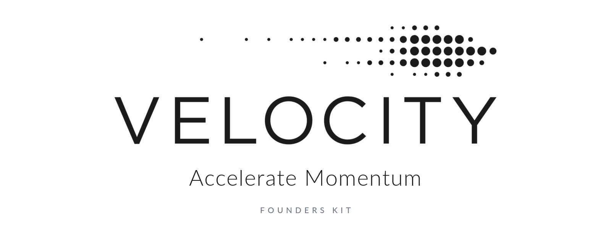

<p align="center">
  <picture>
    <source media="(prefers-color-scheme: dark)" srcset="assets/hero-dark.png">
    <source media="(prefers-color-scheme: light)" srcset="assets/hero-light.png">
    
  </picture>
</p>

# Founders Kit: Velocity Edition ⚙️

> **Accelerate Momentum.** Every important Velocity link, event and signup in one place, plus tools and Claude skills for the work that gets founders in: customer discovery, cold outreach, letters of intent and applications.

[](https://github.com/bing1100/founders-kit-velocity)
[](https://github.com/bing1100/founders-kit-velocity/network)
[](https://github.com/bing1100/founders-kit-velocity/issues)
[](#-contributing)
[](LICENSE)
[](docs/sources.md)

> [!NOTE]
> **Unofficial and community-maintained.** This kit isn't produced or endorsed by Velocity or the University of Waterloo. [velocityincubator.com](https://www.velocityincubator.com/) is the source of truth for rules, dates and amounts. The Velocity name and logo belong to their owners.

## About

[Velocity](https://www.velocityincubator.com/) is the University of Waterloo's free, no-equity startup program. Since 2008 it has helped the founders of 500+ startups reach a combined enterprise value of $40B+. Its information is spread across dozens of pages, forms and partner sites, and some of the most useful pages, like the [discounts page](https://www.velocityincubator.com/discounts), aren't in the site's menu.

This kit builds on the [Founders Kit](https://github.com/avinash201199/founders-kit) directory and focuses it on Velocity founders. It gathers the links, events and FAQ answers into one page. It adds tools and Claude skills for the evidence Velocity weighs most: real customer conversations, plain language, bottom-up market sizing and proof that customers would buy.

## Who Is This For?

- **UW students, researchers, faculty and staff** exploring an idea, with or without a cofounder, prototype or coding skills
- **Founders applying to the Velocity incubator**, or reapplying
- **Velocity founders** who want every signup, grant and contact in one place
- **Anyone building in Waterloo Region** who wants a fast, practical startup toolkit

## What's Inside?

- **Velocity Quick Links:** apply, book a coach, spaces, grants, newsletter and contacts
- **Events & Pitches:** what's on now, recurring competitions, and how to never miss a signup
- **Programs & Funding:** every Velocity and UW program and non-dilutive award, with eligibility and prerequisites
- **Incubator Guide:** the application process, what reviewers look for, and the FAQ ([full guide](docs/velocity-guide.md))
- **Founder Tools:** cold outreach, a letter-of-intent generator, an application checker and an event radar ([tools](tools/))
- **Claude Skills:** 14 skills from idea validation to fundraising ([skills](skills/))
- **Startup Stack:** verified links curated from the original Founders Kit

## Quick Start

| You are... | Start here |
|---|---|
| A UW student with an idea, or no idea yet | [Get started form](https://forms.fillout.com/t/5ZQrB5NE7Pus) → [Cornerstone](#programs) → [book a coach](https://www.velocityincubator.com/velocity-expert-community) |
| Looking for money that doesn't cost equity | [Funding & Awards](#funding--awards) → skill `funding-finder` |
| Applying to the incubator | [Incubator Guide](#the-incubator) → [`velocity-check`](tools/velocity-check/) → skill `velocity-application` |
| Needing customer evidence | [`automated-outreach`](tools/automated-outreach/) → skill `customer-discovery` → [`loi-generator`](tools/loi-generator/) |
| A researcher commercializing your work | [Up Start, ARC and Lab2Market](#programs) → [WatCo and IP](#waterloo--canadian-ecosystem) → skill `ip-readiness` |
| Preparing to pitch | [Events & Pitches](#events--pitches) → skill `two-minute-pitch` |
| Raising money | [Velocity Fund](#velocity-fund--investors) → skill `fundraise-prep` |

## 📋 Table of Contents

- [Velocity Quick Links](#velocity-quick-links)
- [Events & Pitches](#events--pitches)
- [Programs](#programs)
- [Funding & Awards](#funding--awards)
- [The Incubator](#the-incubator)
- [Coaching, Spaces & Equipment](#coaching-spaces--equipment)
- [Velocity Fund & Investors](#velocity-fund--investors)
- [Discounts & Credits](#discounts--credits)
- [Waterloo & Canadian Ecosystem](#waterloo--canadian-ecosystem)
- [Founder Tools](#founder-tools)
- [Claude Skills](#claude-skills)
- [Startup Stack](#startup-stack)
- [Contributing](#-contributing)

---

## Velocity Quick Links

| I want to... | Link |
|---|---|
| **Apply to the incubator** (rolling, ~30 min) | [Application form](https://forms.fillout.com/t/ocQRRAT8bLus) · [Apply page and FAQ](https://www.velocityincubator.com/apply) |
| **Get started as a UW student** | [Get started form](https://forms.fillout.com/t/5ZQrB5NE7Pus) · [Students page](https://www.velocityincubator.com/students) |
| **Book a 1:1 coach** | [Velocity Expert Community](https://www.velocityincubator.com/velocity-expert-community) · [booking form](https://form.fillout.com/t/5ZQrB5NE7Pus) |
| **See grants and awards** | [Non-dilutive awards and grants](https://www.velocityincubator.com/non-dilutive-awards-and-grants-velocity) |
| **Use campus spaces or the AI server** | [Spaces](https://www.velocityincubator.com/programs-events/student-spaces) · [application and registration form](https://forms.fillout.com/t/c7bgNiDSFGus) |
| **Learn what the incubator offers** | [How we help](https://www.velocityincubator.com/how-we-help) |
| **Get member deals** | [Discounts and offers](https://www.velocityincubator.com/discounts). Request codes from Velocity. |
| **Stay in the loop** | [Mailing list](https://www.velocityincubator.com/newsletter-subscribe) · [LinkedIn](https://www.linkedin.com/company/uwvelocity) · [Instagram](https://www.instagram.com/uwvelocity/) · [YouTube](https://www.youtube.com/@uwvelocity) · [Threads](https://www.threads.net/@uwvelocity) · [X](https://twitter.com/uwvelocity) |
| **Browse Velocity companies** | [Companies](https://www.velocityincubator.com/companies) |
| **Read the impact report** | [Momentum 02 (2025)](https://www.velocityincubator.com/momentum-2025) · [Momentum 01](https://www.velocityincubator.com/momentum/freedom-to-innovate) |
| **Read the news** | [News](https://www.velocityincubator.com/news) · [Search the site](https://www.velocityincubator.com/search) |
| **Contact Velocity** | [Contact form](https://www.velocityincubator.com/contact-us) · info@velocityincubator.com · student events: velocity.events@uwaterloo.ca |
| **Volunteer as an alum or advisor** | [Advisor sign-up](https://form.fillout.com/t/5du8qc3XELus) |
| **Sponsor or partner** | [Sponsors](https://www.velocityincubator.com/sponsors) · [Give](https://www.velocityincubator.com/give) |
| **Read the rules** | [Code of Conduct](https://www.velocityincubator.com/code-of-conduct) · [Equity, Diversity & Inclusion](https://www.velocityincubator.com/how-we-help#EDI) |

**Where:** the incubator is at the Innovation Arena, 280 Joseph St, Suite 2000, Kitchener ([map](https://maps.app.goo.gl/NovVUMPL6y3rxCEN6)). Campus spaces are in SCH 228 (digital), ESC 102B (hardware), MC 2037 (common room) and the science lab ([details](docs/velocity-guide.md#spaces-and-equipment)). Office hours are Monday to Friday, 9:00 to 4:30 ET.

---

## Events & Pitches

> Dates are as of **2026-11-05**. Run `python tools/velocity-radar/radar.py` for a live list, or check the [Students page](https://www.velocityincubator.com/students).

### Happening Now

| When | Event | What it is | Sign up |
|---|---|---|---|
| **Nov 2-18, 2026** | [Blockchain Innovation Challenge, powered by Stellar](https://www.velocityincubator.com/programs-events/the-blockchain-innovation-challenge-powered-by-stellar) | Two-week challenge for UW students, building financial-inclusion tools on Stellar. $15K in prizes. Top 16 showcase on Nov 16; Top 8 finals on Nov 18, 5:00-7:30 pm, at the Innovation Arena. | Underway: the kick-off on Nov 2 was mandatory. [Event page](https://www.velocityincubator.com/programs-events/the-blockchain-innovation-challenge-powered-by-stellar) |
| **Mon Nov 16, 2026**, 4:45-7:00 pm | [Co-op Workplace Simulation](https://www.velocityincubator.com/programs-events/velocity-co-op-innovation-challenge) | Practice spotting real business problems at a simulated healthcare company. It leads to the [Co-op Problem Award](https://uwaterloo.ca/co-operative-education/co-op-student-awards/velocity-co-op-problem-award). PSE, 2nd floor IDEAs Clinic. | [**Register**](https://airtable.com/appsLpsmcadbUEjvA/pagazyQHGqQcAlgml/form) |
| **End of Nov 2026** | [Anuj Jain Family Award](https://www.velocityincubator.com/non-dilutive-awards-and-grants-velocity) ($5,000) | For UW students on an Enterprise Co-op who have completed Cornerstone (fall term award) | [**Apply**](https://forms.fillout.com/t/jmzhbdMdtqus) |
| **Jan 2027 intake** | [Incubator onboarding](https://www.velocityincubator.com/apply) | Rolling applications; teams are onboarded in Jan, Mar, May, Jul, Sep and Nov. Allow 1-3 months from application to decision. | [**Apply**](https://forms.fillout.com/t/ocQRRAT8bLus) |

### Pitch Competitions & Challenges

These repeat. The dates show the most recent run, so watch the page for the next one.

| Event | What it is | Prize | Last ran | Link |
|---|---|---|---|---|
| **Velocity Pitch Competition (VPC)** | UW student teams pitch for two minutes with no slides. In 2026: 100 pitches, 100 judges, and the top 10 in the finals. At least one member must be a current UW student or postdoc, and the team must have under $55K in funding or revenue. | $5K top prize | Sep 12, 2026 (Waterloo Tech Week) | [Program](https://www.velocityincubator.com/programs-events/vpc) · [Finals](https://www.velocityincubator.com/programs-events/velocity-pitch-competition) · [Past pitches](https://www.youtube.com/@uwvelocity) |
| **VPC All-Stars ("Velocity 25K")** | Current and past Waterloo founders pitch for one large award | $25K first place | Apr 1, 2025 | [Event page](https://www.velocityincubator.com/programs-events/vpc-all-stars) |
| **Innovation Challenges** | Two-week sprints on real industry problems, ending in a showcase and finals. Topics so far: blockchain, agri-food, future cities, AgeTech, health. | $10K-$15K pools | Nov 2026 (Blockchain) | [Agri-food](https://www.velocityincubator.com/programs-events/agri-food-innovation-challenge) · [Future Cities](https://www.velocityincubator.com/programs-events/future-cities-innovation-challenge) · [AgeTech](https://www.velocityincubator.com/programs-events/agetech-innovation-challenge) · [Health](https://www.velocityincubator.com/programs-events/health-innovation-challenge) |
| **Speed Challenges** | Race-the-clock problem-solving sessions with partners | Varies | Mar 24, 2026 (Cooperathon) | [Cooperathon × Velocity](https://www.velocityincubator.com/programs-events/cooperathon-powered-by-desjardins-x-velocity-speed-challenge) · [Future Cities × Velocity](https://www.velocityincubator.com/programs-events/future-cities-x-velocity-speed-hack) |
| **Cooperathon, powered by Desjardins** | Open-innovation competition run by Desjardins | Up to $100K | AMA Apr 15, 2026 | [Velocity AMA page](https://www.velocityincubator.com/programs-events/cooperathon-powered-by-desjardins-online-info-session-and-fireside-chat) · [cooperathon.ca](https://www.cooperathon.ca/) |
| **Jack Rosen Memorial Award** | UW pitch competition for social or environmental impact | See page | Annual | [UW profile](https://uwaterloo.ca/entrepreneurship/profiles/jack-rosen-memorial-award-pitch-competition) |
| **YC Prep Session** | Feedback on your Y Combinator application from Velocity's YC alumni | | Oct 6, 2026 | [Event page](https://www.velocityincubator.com/programs-events/yc-prep-session) · [YC Apply](https://www.ycombinator.com/apply) |
| **Deep Tech Geeks competition** | Deep-tech founders compete for a trip to a global tech showcase in Dubai | Trip | Jul 2025 | [Event page](https://www.velocityincubator.com/programs-events/deep-tech-geeks-startup-competition) |

> Pitching an invention in public can affect your patent rights. Read [IP](#waterloo--canadian-ecosystem) first, or run the `ip-readiness` skill.

### Workshops, Talks & Community

| Event | What it is | Last ran | Link |
|---|---|---|---|
| **Startup 101** | Founder-led talks for everyone, from ideation to funding | Jul 2025 | [Series page](https://www.velocityincubator.com/programs-events/startup-101) |
| **Insight to Creation speaker series** | Founder journeys | Jan 2026 | [Event page](https://www.velocityincubator.com/programs-events/a-founders-journey-from-ground-to-flight) |
| **Innovation Open House** | Meet Waterloo's entrepreneurial community | Sep 9, 2026 | [Event page](https://www.velocityincubator.com/programs-events/innovation-open-house-mixer) |
| **Student Startup Panel at Waterloo Tech Week** | Student founders on starting up at UW | Sep 15, 2026 | [Event page](https://www.velocityincubator.com/programs-events/velocity-student-startup-panel-at-waterloo-tech-week) |
| **Startup 2 Scaleup** | Startup job fair, plus sessions on funding, talent and mentorship | Oct 29, 2026 | [Event page](https://www.velocityincubator.com/programs-events/startup-2-scaleup) |
| **Health innovation events** | Velocity's health ecosystem: talks and networking | Oct 2025 | [Tech and healthcare](https://www.velocityincubator.com/programs-events/technology-needs-to-keep-up-with-healthcare-but-how) · [Recent grads in health](https://www.velocityincubator.com/programs-events/how-recent-grads-are-shaping-the-future-of-healthcare) |
| **Hands-on workshops** | For example, building a site with the Framer team | Nov 2025 | [Framer workshop](https://www.velocityincubator.com/programs-events/design-to-launch-building-interactive-websites-with-framer) |
| **Women in entrepreneurship** | International Women's Day retreat and fireside chats | Mar 2026 | [IWD 2026](https://www.velocityincubator.com/programs-events/iwd-2026---give-to-rise-a-micro-retreat-skill-sessions) |
| **Founder Breakfasts and Founder-Funder Mixers** | Founders, friends and funders; 1:1 and group networking, plus pitches | Ongoing | Listed on the [Sponsors page](https://www.velocityincubator.com/sponsors). Watch the incubator Slack and newsletter. |

### Never Miss a Signup

1. **Join the [mailing list](https://www.velocityincubator.com/newsletter-subscribe).**
2. **Ask for reminders.** Each program page has a "Sign up for a reminder email" box covering Cornerstone, Up Start, Startup 101 and Innovation Challenges.
3. **Join the student Discord** through the [Get started form](https://forms.fillout.com/t/5ZQrB5NE7Pus).
4. **Follow [@uwvelocity](https://www.instagram.com/uwvelocity/)** for community news.
5. **Run the radar:** `python tools/velocity-radar/radar.py --days 90` lists upcoming events with direct signup links.

---

## Programs

All free, with no equity taken. "Last cycle" dates are past runs, so check each page for the next one.

| Program | For | What you get | Timing | Link |
|---|---|---|---|---|
| **Cornerstone** | Students and researchers in any faculty. At least one member must be a current UW, Laurier or Conestoga student. | A 10-day sprint to meet real customers: mentors, workshops, Discord, and a final dinner with $2,500 in prizes. **Required for several awards.** | Every term (Fall 2026: Sep 17 to Oct 8) | [Program](https://www.velocityincubator.com/programs-events/cornerstone) |
| **Up Start** | UW undergrads, grads, researchers, staff, and grads within a year of graduating | Commercialization training with Velocity and WatCo: biweekly advisors, and up to **$15K** tied to milestones. No requirement to become a WatCo client. | Last cycle: pitches in Oct 2025 | [Program](https://www.velocityincubator.com/programs-events/up-start) · [Apply](https://forms.fillout.com/t/pzeqT8mpdYus) |
| **Summer Accelerator** | Teams of current students, recent grads or postdocs from any Ontario post-secondary institution; up to 30 teams | 3 months (May to Aug): a **$12K** IPON fellowship per team, coworking, coaching, IP education and a demo day | 2026 deadline was Apr 5 | [Program](https://www.velocityincubator.com/programs-events/summer-accelerator) |
| **Academy of Research Commercialization (ARC)** | Admitted UW PhD students in deep tech | Five modules over six months (Nov to May), a completion stipend, and up to **$30K** in seed funding | 2026 deadline was Nov 2 | [Velocity page](https://www.velocityincubator.com/programs-events/academy-of-research-commercialization) · [Conrad School](https://uwaterloo.ca/conrad-school-entrepreneurship-business/graduate-students/academy-research-commercialization-arc) |
| **Lab2Market Launch** | Entrepreneurial grad students and research teams | Four-month immersive program with **$10K** in funding | Spring 2026 deadline was Nov 30, 2025 | [Velocity page](https://www.velocityincubator.com/programs-events/lab2market) · [lab2market.ca](https://www.lab2market.ca/launch) |
| **1:1 Student Coaching** | UW community | Experts in 13 areas, from AI to health to fundraising | Anytime | [Experts](https://www.velocityincubator.com/velocity-expert-community) |
| **AI Server** | Current UW students | Free GPU computing: 4× NVIDIA L40S (48 GB) and 2 TB RAM | Anytime | [Program](https://www.velocityincubator.com/programs-events/ai-server) · [Register](https://forms.fillout.com/t/c7bgNiDSFGus) |
| **Spaces** | UW students; science spaces also open to grads, postdocs and faculty-founded teams | Hardware, science lab, digital and common-room spaces, renewed each term | Rolling | [Program](https://www.velocityincubator.com/programs-events/student-spaces) |
| **i-Capstone: Future Cities** | UW students | Collaborative course on future-ready cities | Fall and winter | [Program](https://www.velocityincubator.com/programs-events/icapstone) |
| **Co-op Workplace Simulation** | Students in all faculties | Practice spotting problems; a route to the Co-op Problem Award | Each term | [Program](https://www.velocityincubator.com/programs-events/velocity-co-op-innovation-challenge) |
| **Campus Ambassador** | Current UW students | Promote Velocity, run events, build your network | 2026 deadline was Sep 7 | [Program](https://www.velocityincubator.com/programs-events/velocity-campus-ambassador) |
| **Startup 101** | Everyone | Founder-led talk series | Recurring | [Program](https://www.velocityincubator.com/programs-events/startup-101) |
| **Velocity Incubator** | Full-time founders, from anywhere | Workspace, coaching, labs, hardware shop, network and investor introductions | Rolling; intake every 2 months | [The Incubator](#the-incubator) |

The full UW list of 30+ programs is at [UW Entrepreneurship programs](https://uwaterloo.ca/entrepreneurship/programs).

---

## Funding & Awards

Non-dilutive money. Velocity reports granting **$3.5M** to students and pre-seed founders since 2008. Check each page before you plan around a deadline, or run the `funding-finder` skill.

| Award | Amount | For | Prerequisite | Deadline | Link |
|---|---|---|---|---|---|
| **Abundance Award for Women** | $25,000 (one a year) | Women-identifying UW undergrad or grad students engaged with Velocity who plan to keep working on the startup after graduating | Cornerstone | April | [Apply](https://forms.fillout.com/t/vfScNgRU4Nus) |
| **Anuj Jain and Nitin Jain Family Awards** | $5,000 each | UW students on an [Enterprise Co-op](https://uwaterloo.ca/conrad-school-entrepreneurship-business/undergraduate-students/enterprise-co-op) | Cornerstone | End of Nov (fall); end of Mar (winter) | [Apply](https://forms.fillout.com/t/jmzhbdMdtqus) |
| **Velocity Momentum Grants** | $10,000 | New UW grads, and students working with Velocity. Priority for full-time grads and Summer Accelerator alumni. A limited number each year. | Join Cornerstone and/or meet an advisor | Rolling | [Book an advisor](https://forms.fillout.com/t/5ZQrB5NE7Pus) |
| **Up Start** | Up to $15,000 | UW students, researchers and staff | Cornerstone strongly affects selection | Per cycle | [Program](https://www.velocityincubator.com/programs-events/up-start) |
| **Summer Accelerator fellowship** (IPON) | $12,000 per team | Ontario students, recent grads and postdocs | Full-time in person for the summer | Spring | [Program](https://www.velocityincubator.com/programs-events/summer-accelerator) |
| **ARC seed funding** | Up to $30,000, plus a stipend | UW deep-tech PhD students | Complete ARC | Fall | [Program](https://www.velocityincubator.com/programs-events/academy-of-research-commercialization) |
| **Lab2Market Launch** | $10,000 | Grad students and research teams | | Fall, for spring | [lab2market.ca](https://www.lab2market.ca/launch) |
| **Co-op Problem Award** | $1,500 top; $750 second; up to 10 × $500 | Students analyzing a real co-op workplace problem | The Co-op Workplace Simulation | Rolling | [Award](https://uwaterloo.ca/co-operative-education/co-op-student-awards/velocity-co-op-problem-award) |
| **WIN-Velocity Scholarship** | Equivalent to a two-year Graduate Research Studentship | Domestic first-year research master's students in Engineering or Science building a deep-tech startup | A WIN supervisor whose research matches | Every term | [Program](https://uwaterloo.ca/entrepreneurship/profiles/win-velocity-scholarship-program) |
| **Competition prizes** | $2.5K (Cornerstone) to $25K (All-Stars) | See [Events & Pitches](#events--pitches) | | Per event | |
| **Entrepreneurial PhD Fellowship** | See page | Conrad School graduate students | | September | [Program](https://uwaterloo.ca/entrepreneurship/profiles/entrepreneurial-phd-fellowship) |
| **Social Impact Fund** | See page | GreenHouse students | | Every term | [Program](https://uwaterloo.ca/entrepreneurship/profiles/social-impact-fund-sif) |

More: the [UW funding finder](https://uwaterloo.ca/entrepreneurship/program-finder/funding), and Canadian programs below in the [ecosystem section](#waterloo--canadian-ecosystem).

---

## The Incubator

Free workspace, coaching, labs and network for **full-time** founders. No equity is taken and nothing is charged. Velocity accepts about **10%** of applicants. The [**full guide**](docs/velocity-guide.md) covers the complete FAQ, the review criteria and what happens after you're accepted.

**Before you apply, check you can commit to these:**
- Every founder is **full-time**. Part-time founders aren't accepted.
- You'll work **from Velocity in Kitchener at least 1 day a week** (ideally 5-7) for the first 3 months, and join coaching and programming.
- The business is one a university can support. Gambling, firearms and illicit substances, for example, are out.

Any industry is welcome, as are solo founders (though teams of 2-4 do better), non-technical founders, unincorporated teams, idea-stage teams with strong execution, and founders who've raised money or done other accelerators. You don't need to be a UW alum. If you're in Canada on a visa, talk to an immigration lawyer, and note that Canada's [Start-up Visa](https://www.canada.ca/en/immigration-refugees-citizenship/services/immigrate-canada/start-visa.html) is paused to new applicants.

**Process:** application (30 min) → committee review (1-2 weeks) → virtual interview → assigned milestones (1-2 weeks) → **you complete them (1-6 weeks)** → second review.

**What reviewers look for, according to Velocity's tips:**

| | Do | Don't |
|---|---|---|
| **Customer discovery** | Give counts, dates, who you spoke to and how you reached them | Rely on people you already know, or a small survey |
| **Founders** | Show how long you've known each other and what you've survived together | Say "we studied the same program" |
| **Clarity** | Write plainly: what it does, for whom, at what price | Use "platform" or "solution", or write 50 words where 10 would do |
| **Market** | Give customer counts, segments, price and why you'll convert them | Lead with a market-report total or CAGR |

Check your draft with [`velocity-check`](tools/velocity-check/) and the `velocity-application` skill. If you're rejected, read [YC's take on why](https://www.ycombinator.com/whynot), keep validating, and reapply with what changed.

<details>
<summary><b>What you get once you're in</b></summary>

- **Community:** peers 0-18 months ahead of you, and a shared Slack. There are no formal cohorts.
- **Coaching:** advisors with industry expertise, many of whom have founded companies.
- **Network:** introductions to investors, service providers and customers, which you **earn** by engaging.
- **Workspace:** about 45,000 sq ft in the Innovation Arena, with pods for 60-80 startups, up to 10 desks per company, and extended hours.
- **Hardware:** laser cutters, 3D printers, electronics test equipment, a paint room, a wood and metal shop, and an open build area.
- **Labs:** $1.5M+ of analytical equipment and a certified Biosafety Level 2 lab. Training is required.
- **Funding:** access to the [Velocity Fund](#velocity-fund--investors), plus relationships with VCs in Canada, the US and beyond.
- **Time:** a couple of hours of programming a week at the start. Founders who engage most are considered first for funding and media opportunities.

</details>

---

## Coaching, Spaces & Equipment

- **[Velocity Expert Community](https://www.velocityincubator.com/velocity-expert-community):** 1:1 coaching. Experts cover AI, B2B sales, business development, consumer and retail, edtech, fintech, fundraising and grants, hardware, health, marketing, idea validation, product development and software. [Book a session](https://form.fillout.com/t/5ZQrB5NE7Pus). Cancel at least 24 hours ahead: more than two no-shows ends your eligibility.
- **[Campus spaces](https://www.velocityincubator.com/programs-events/student-spaces):** digital (SCH 228), science lab, hardware (ESC 102B) and common room (MC 2037). [Apply](https://forms.fillout.com/t/c7bgNiDSFGus).
- **[AI Server](https://www.velocityincubator.com/programs-events/ai-server):** free for UW students. 2× Xeon Platinum 8580, 4× NVIDIA L40S and 2 TB RAM.
- **[Innovation Arena core facility](https://uwaterloo.ca/innovation-arena/core-facility/become-facility-user):** labs and equipment for users outside Velocity. See [memberships and fees](https://uwaterloo.ca/innovation-arena/core-facility/memberships-and-fees).

---

## Velocity Fund & Investors

- **[Velocity Fund](https://velocity.fund/)** is a pre-seed fund at the entrance to the incubator, anchored by the UW Endowment. It is separate from the free incubator. Its site lists:
  - **Cheques:** $25K scout cheques; core cheques up to $1M ([$100K or $150K minimum, depending on the page](docs/sources.md))
  - **Terms:** leads rounds for 5-7.5% ownership
  - **Speed:** a decision within two weeks of the first meeting
  - Read [How they work](https://velocity.fund/how-we-help.html) · [Portfolio](https://velocity.fund/portfolio.html) · [Team](https://velocity.fund/team.html) · hello@velocity.fund
- **Investor introductions** through the incubator must be earned. Velocity says the founders who engage most are considered first.
- **Before you raise:** read [YC's guide to seed fundraising](https://www.ycombinator.com/library/4A-a-guide-to-seed-fundraising), [*Venture Deals*](https://venturedeals.com/) and [YC's SAFE documents](https://www.ycombinator.com/documents), which include **Canadian** versions. Have a lawyer review anything before you sign. The skill `fundraise-prep` walks you through it.

---

## Discounts & Credits

**Velocity member deals:** Velocity companies have access to hundreds of deals. Partners must offer at least $5,000 in value, 100% off for a year, or 50% off for two years. To protect the codes, **you request each code or an introduction from Velocity directly**. ([Discounts page](https://www.velocityincubator.com/discounts))

**Public startup programs** (from the Founders Kit; links checked 2026-11-05):

| Category | Programs |
|---|---|
| Cloud | [AWS Activate](https://aws.amazon.com/startups/) · [Google Cloud for Startups](https://cloud.google.com/startup) · [Microsoft for Startups](https://www.microsoft.com/en-ca/startups) · [DigitalOcean for Startups](https://www.digitalocean.com/startups) · [MongoDB for Startups](https://www.mongodb.com/solutions/startups) |
| Analytics | [Mixpanel for Startups](https://mixpanel.com/startups/) · [Amplitude for Startups](https://amplitude.com/startups) |
| Sales & support | [HubSpot for Startups](https://www.hubspot.com/startups) · [Intercom Early Stage](https://www.intercom.com/early-stage) · [Zendesk for Startups](https://www.zendesk.com/business/startups/) |
| Hardware & engineering | [SOLIDWORKS for Startups](https://www.solidworks.com/solution/organization-type/entrepreneurs-startups) · [Autodesk Fusion for Startups](https://www.autodesk.com/products/fusion-360/startups) · [MATLAB and Simulink for Startups](https://mathworks.com/products/startups.html) |

---

## Waterloo & Canadian Ecosystem

**University of Waterloo**
- [UW Entrepreneurship](https://uwaterloo.ca/entrepreneurship/): [all programs](https://uwaterloo.ca/entrepreneurship/programs) · [funding finder](https://uwaterloo.ca/entrepreneurship/program-finder/funding)
- [Conrad School of Entrepreneurship and Business](https://uwaterloo.ca/conrad-school-entrepreneurship-business/) · [Enterprise Co-op](https://uwaterloo.ca/conrad-school-entrepreneurship-business/undergraduate-students/enterprise-co-op), which lets you work on your startup as a co-op term
- [Innovation Arena](https://uwaterloo.ca/innovation-arena/)

**Intellectual property**
- UW is **creator-owned** under [Policy 73](https://uwaterloo.ca/secretariat/policies-procedures-guidelines/policies/policy-73-intellectual-property-rights) ([summary](https://uwaterloo.ca/entrepreneurship/our-ip-policy)). Read the details for your situation: grants, sponsored research, supervisors and co-op employers can all affect who owns what.
- [WatCo, the Waterloo Commercialization Office](https://uwaterloo.ca/research/waterloo-commercialization-office-watco): IP protection and licensing help ([work with WatCo](https://uwaterloo.ca/research/waterloo-commercialization-office-watco/commercialization-services/work-watco))
- [Intellectual Property Ontario (IPON)](https://ip-ontario.ca/) · [Canadian Intellectual Property Office](https://ised-isde.canada.ca/site/canadian-intellectual-property-office/en)
- **Before you pitch or publish an invention,** talk to WatCo or a patent professional. Public disclosure can cost you patent rights, especially outside Canada.

**Waterloo Region**
- [Communitech](https://www.communitech.ca/) · [Accelerator Centre](https://www.acceleratorcentre.com/). Velocity says it will help you join other programs alongside it.

**Canada**
- [NRC IRAP](https://nrc.canada.ca/en/support-technology-innovation/about-nrc-industrial-research-assistance-program): advice and funding for R&D
- [SR&ED tax incentives](https://www.canada.ca/en/revenue-agency/services/scientific-research-experimental-development-tax-incentive-program.html): tax credits for R&D. Talk to an accountant.
- [Mitacs](https://www.mitacs.ca/): research internships · [BDC startup financing](https://www.bdc.ca/en/financing/starting-business-loan) · [BDC Capital](https://www.bdc.ca/en/bdc-capital)
- Incorporating: [Corporations Canada](https://ised-isde.canada.ca/site/corporations-canada/en) (federal) or the [Ontario Business Registry](https://www.ontario.ca/page/ontario-business-registry) (provincial). Velocity can guide you.
- Rules for outreach: [Canada's anti-spam legislation (CASL)](https://crtc.gc.ca/eng/internet/anti.htm). For health data in Ontario, see the [IPC's guidance for health information custodians](https://www.ipc.on.ca/en/health-organizations).

---

## Founder Tools

Small Python tools in [`tools/`](tools/). Your data stays on your machine, and real contacts go in `*.local.*` files, which git ignores.

| Tool | What it does |
|---|---|
| [**automated-outreach**](tools/automated-outreach/) | Sends personalized cold emails from your own Microsoft 365 or UW mailbox through Microsoft Graph, a few at a time from a CSV. Dry run, test-to-self, resume after interruption and no duplicate sends. No admin rights needed. |
| [**loi-generator**](tools/loi-generator/) | Drafts **letters of intent** (customer, pilot, design partner, health pilot, letter of support, partnership) as .docx, HTML or Markdown. Scores how specific each letter is, flags vague or binding-sounding wording, and tracks a pipeline that never counts expired letters. |
| [**velocity-check**](tools/velocity-check/) | Checks an application against Velocity's published criteria. Turns a conversation log into evidence with counts, checks a bottom-up market size, and lints for buzzwords. |
| [**velocity-radar**](tools/velocity-radar/) | Lists upcoming Velocity events and their signup links, live from the website. |

```bash
git clone https://github.com/bing1100/founders-kit-velocity.git && cd founders-kit-velocity
python tools/velocity-radar/radar.py --days 90                              # what's coming up
python tools/velocity-check/check.py lint my-answers.md                     # buzzword check
python tools/loi-generator/loi.py build tools/loi-generator/examples/pilot.example.json
```

**What's next:** a deadline calendar feed, a runway and dilution calculator, a customer quote bank, an investor CRM and more. See the [ranked brainstorm](tools/README.md#brainstorm-tools-worth-building-next).

---

## Claude Skills

Fourteen [Claude Code skills](https://code.claude.com/docs/en/skills) written for Velocity founders. They never invent evidence, they check live pages for rules and deadlines, and they never send anything for you. [Install and details](skills/).

```
/plugin marketplace add bing1100/founders-kit-velocity
/plugin install velocity@founders-kit-velocity
```

| Stage | Skills |
|---|---|
| **Explore** | `validate-idea` · `customer-discovery` · `cold-outreach` |
| **Prove demand** | `market-sizing` · `loi-drafter` · `pilot-design` |
| **Apply and fund** | `velocity-application` · `funding-finder` · `two-minute-pitch` · `fundraise-prep` |
| **Run the company** | `weekly-sprint` · `investor-update` · `founder-alignment` · `ip-readiness` |

Ideas came from [emotixco/claude-skills-founder](https://github.com/emotixco/claude-skills-founder), [slavingia/skills](https://github.com/slavingia/skills) and [ognjengt/founder-skills](https://github.com/ognjengt/founder-skills), which pair well with these.

---

## Startup Stack

Curated from the [Founders Kit](https://github.com/avinash201199/founders-kit) for early-stage founders. Each link was checked on 2026-11-05.

### Learn
- **Essays:** [How to Get Startup Ideas](https://paulgraham.com/startupideas.html) · [Do Things That Don't Scale](https://paulgraham.com/ds.html) · [18 Mistakes That Kill Startups](https://paulgraham.com/startupmistakes.html) · [How to Raise Money](https://paulgraham.com/fr.html) · [Maker's Schedule, Manager's Schedule](https://paulgraham.com/makersschedule.html) · [Startup Playbook](https://playbook.samaltman.com/)
- **Libraries:** [NFX Library](https://www.nfx.com/library) · [Mochary Method](https://www.mocharymethod.com/) · [Steve Blank](https://steveblank.com/)
- **Books:** [The Mom Test](https://www.momtestbook.com/) · [Venture Deals](https://venturedeals.com/) · [Inspired](https://www.svpg.com/books/inspired-how-to-create-tech-products-customers-love-2nd-edition/) · [The Cold Start Problem](https://www.coldstartproblem.com/)

### Validate & Discover
- [The Mom Test](https://www.themomtest.com/) · [Empathy Map](https://www.empathymap.com/)
- Product-market fit: [How Superhuman Built an Engine to Find PMF](https://review.firstround.com/how-superhuman-built-an-engine-to-find-product-market-fit/) · [12 Things About Product-Market Fit](https://a16z.com/12-things-about-product-market-fit)
- Market research: [Google Trends](https://trends.google.com/trends/) · [Statista](https://www.statista.com/) · [Similarweb](https://www.similarweb.com/) · [Crunchbase](https://www.crunchbase.com/)

### Fundraise
- [YC: A Guide to Seed Fundraising](https://www.ycombinator.com/library/4A-a-guide-to-seed-fundraising) · [YC SAFE documents](https://www.ycombinator.com/documents) · [How to Raise Money](https://howtoraise.money/) · [Options vs. Cash](https://danluu.com/startup-options/)
- Decks: [30 Legendary Pitch Decks](https://slidebean.com/pitch-deck-examples) · [Beautiful.ai](https://www.beautiful.ai/) · [Canva](https://www.canva.com/)
- Programs: [Y Combinator](https://www.ycombinator.com/) · [accelerator.directory](https://accelerator.directory/)

### Build
- Design: [Figma](https://www.figma.com/) · [unDraw](https://undraw.co/)
- Sites: [Framer](https://www.framer.com/) · [Webflow](https://webflow.com/) · [Carrd](https://carrd.com/)
- Backend: [Supabase](https://supabase.com/) · [Firebase](https://firebase.google.com/) · [Airtable](https://www.airtable.com/)
- Payments: [Stripe](https://stripe.com/)
- Automation: [n8n](https://n8n.io/) · [Zapier](https://zapier.com/)

### Measure
- Product analytics: [PostHog](https://posthog.com/) · [Microsoft Clarity](https://clarity.microsoft.com/) · [Metabase](https://www.metabase.com/)
- Reliability: [Sentry](https://sentry.io/) · [UptimeRobot](https://uptimerobot.com/)

### Sell & Support
- [HubSpot](https://www.hubspot.com/) · [Calendly](https://calendly.com/) · [Loom](https://www.loom.com/) · [Postmark](https://postmarkapp.com/) · [Really Good Emails](https://www.reallygoodemails.com/)
- Feedback: [Canny](https://canny.io/) · [Testimonial](https://testimonial.to/)

### Run the Team
- [Linear](https://linear.app/) · [Slack](https://slack.com/) · [Notion](https://www.notion.com/)
- Hiring: [Job Interviews Don't Work](https://fs.blog/job-interviews/)

### Launch & Community
- [Product Hunt](https://www.producthunt.com/) · [Hacker News](https://news.ycombinator.com/) · [BetaList](https://betalist.com/) · [Indie Hackers](https://www.indiehackers.com/) · [r/startups](https://www.reddit.com/r/startups/)

For hundreds more tools, by category, see the [original Founders Kit](https://github.com/avinash201199/founders-kit).

---

## 🤝 Contributing

Velocity's pages change every term, so corrections are the most valuable contribution.

1. **Fix a date, amount or link.** Cite the Velocity page you checked, and update "last checked".
2. **Add a resource.** It should help Velocity or Waterloo founders specifically. Check for duplicates, and don't add affiliate or referral links.
3. **Improve a tool or skill.** Keep tools small and local-first, with tests (`python -m unittest discover -s tests` in each tool). Skills must never invent evidence or send on the founder's behalf.
4. **Before opening a PR,** run `python scripts/check_links.py`.

Please never commit real contact lists, deal files or send logs. Name them `*.local.*`.

## 📜 License

MIT. See [LICENSE](LICENSE). Parts of the Startup Stack are adapted from [Founders Kit](https://github.com/avinash201199/founders-kit) by Avinash Singh (MIT). Velocity and University of Waterloo names, logos and content belong to their owners. They're summarized and linked here, not relicensed.

## Acknowledgments

- [Founders Kit](https://github.com/avinash201199/founders-kit) by Avinash Singh and its contributors, which this kit builds on
- [Velocity](https://www.velocityincubator.com/) and the University of Waterloo, for the programs and the public information this kit organizes
- The founder skill packs listed under [Claude Skills](#claude-skills)

---

*Last checked: 2026-11-05 · [Sources and discrepancies](docs/sources.md)*
